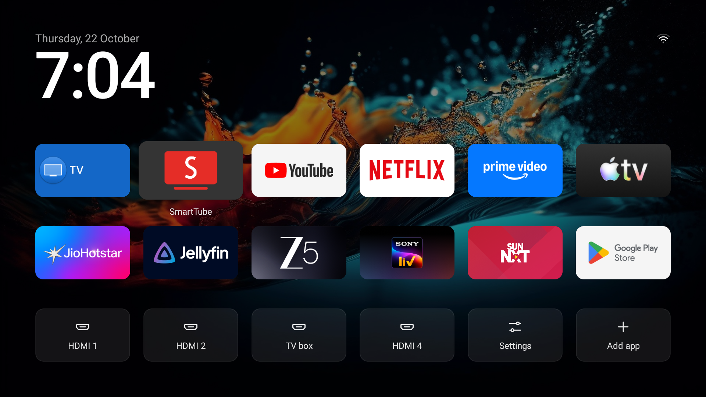

<div align="center">

# TV Detox

<a href="https://www.skool.com/staffed-claude-code-ai-5304"></a>

### Make an old, slow Android TV fast again.

Claude Code or Codex does the work. You just press OK on the remote.

[](https://github.com/Ansub/tv-detox/releases/latest)
[](https://github.com/Ansub/tv-detox/actions)
[](LICENSE)
[](https://www.youtube.com/@ansubkhan)



</div>

<table>
<tr>
<td width="33%" valign="top"><b>🧹 Removes the junk</b><br>Bloatware, ads and sponsored rows, gone.</td>
<td width="33%" valign="top"><b>📺 A calm home screen</b><br>Your apps, your HDMI inputs and a clock. Nothing else.</td>
<td width="33%" valign="top"><b>↩️ Undo anytime</b><br>Apps are turned off, never deleted.</td>
</tr>
</table>

## Watch it work

<a href="https://www.youtube.com/watch?v=fP2SGGVsaB0"></a>

**[▶ Claude Made My Old Android TV Feel Brand New](https://www.youtube.com/watch?v=fP2SGGVsaB0)** · the full setup on a real TV, in 4 minutes.

## Get started

> [!WARNING]
> **Google TV and Chromecast with Google TV:** don't turn off the TV's own home screen. On some of these devices that left them stuck restarting, and the only fix was a factory reset. Since v1.4.1, `install.sh` leaves it on for Google TV unless you opt in with `GOOGLE_TV=1`. The cleanup still works and makes the TV faster. You just keep Google TV's own home screen.

**1. Turn on developer mode on the TV.**
Settings → Device Preferences → About → press **Build** 7 times. Then turn on **USB debugging** in **Developer options**. [Stuck?](#help)

**2. Open [Claude Code](https://claude.com/claude-code) or [Codex](https://openai.com/codex) on your laptop.**
The laptop and TV must be on the same Wi-Fi.

**3. Paste this in.**

```text
Help me clean up my Android TV and make it faster.
My TV is a <brand and model>.

1. Connect to my TV over Wi-Fi. Walk me through anything
   I need to tap on the TV.
2. Before changing anything, list every app in plain English:
   safe to turn off, needed by the TV, and apps I use.
   Check free memory.
3. Ask me before every change. Turn apps off instead of
   deleting them. Keep a list of what you changed and how
   to undo it.
4. Never turn off: Google Play services
   (com.google.android.gms), Google Play, Settings,
   System UI, setup apps, the keyboard, Bluetooth, my HDMI
   inputs, the TV's input and tuner framework, or anything
   else the TV needs to start. On Google TV or Chromecast,
   also never turn off Google TV's home screen
   (com.google.android.apps.tv.launcherx). If you're not
   sure, leave it on.
5. Install the home screen: download
   https://github.com/Ansub/tv-detox and run its
   install.sh with my TV and these apps: <your apps>.
6. Turn off animations and the screensaver, and make the TV
   sleep after 5 minutes.
7. Wait 30 seconds after the last change, then restart the
   TV once and check it starts up normally before you say
   you're done. Show me free memory before
   and after.
```

That's it. It asks you before every change.

> [!NOTE]
> This is what worked for us, not professional advice. Use it at your own risk. You're responsible for your own TV, and I'm not liable if something goes wrong.

## Help

<details>
<summary><b>How do I turn on developer mode?</b></summary>
<br>

1. On the TV, open **Settings**, then **Device Preferences** (or **System**), then **About**.
2. Press OK on **Build** 7 times until you see "You are now a developer."
3. Go back, open **Developer options** and turn on **USB debugging**. If you see **Network debugging** or **Wireless debugging**, turn that on too.
4. The first time your laptop connects, the TV asks "Allow debugging?" Tick "Always allow" and press **Allow**.

**Chromecast with Google TV and other newer Google TVs** usually only have **Wireless debugging**, which needs a pairing code. `install.sh <TV_IP>` alone won't connect. Instead:

1. In **Developer options**, open **Wireless debugging** and choose **Pair device with pairing code**. Leave that screen open.
2. On your laptop, run `adb pair <IP>:<pairing port>` with the IP and port shown under the code, and type the code.
3. Back on the **Wireless debugging** screen, note the IP and port shown there (it's a different port), and run `adb connect <IP>:<port>`.
4. Use that same address for every script: `sh install.sh <IP>:<port>`, `sh undo.sh <IP>:<port>`.

The port changes every time the TV restarts, and the connection can drop. If a script says it can't reach the TV, pair and connect again. Don't restart the TV halfway through a cleanup.

Menus differ a bit by brand. If you're stuck, ask Claude or Codex: *"I have a \<brand and model\> TV. How can you connect to it from my laptop and take control of it?"*

</details>

<details>
<summary><b>Which TVs does it work on?</b></summary>
<br>

Android TV 9 (a real TV), 11 and 12, and Google TV 14 (also a real TCL TV, see [TCL notes](#tcl-notes)). Every change is tested automatically on emulators.

</details>

<details>
<summary><b>Can I do this on a Fire TV, Roku, Samsung or LG?</b></summary>
<br>

- **Amazon Fire TV:** partly. Fire TV is Android underneath, so the cleanup works. Amazon blocks changing the home screen on current Fire TVs, so you keep Amazon's. Tell Claude what you want to keep, like Alexa voice search on the remote.
- **Roku:** no. Roku runs its own system, not Android, so nothing can connect to it to turn things off.
- **Samsung (Tizen):** no, for the same reason.
- **LG (webOS):** no. You can still cut down the ads by turning off **Home Promotion** and **Content Recommendation** in the TV's home settings.

If your TV or streaming box runs Android TV or Google TV, it should work. That includes many Sony, TCL, Hisense, Philips and Xiaomi TVs, Chromecast with Google TV and Nvidia Shield. Some of those brands also sell Roku or other non-Android models, so check **Settings > About** if you're not sure.

</details>

<details>
<summary><b>What about projectors or Android phones?</b></summary>
<br>

- **Android projectors:** probably. If it has **Developer options** and **USB debugging**, the cleanup should work. Cheap projectors often run a custom Android, so the home screen may act a bit differently.
- **Android phones:** only the cleanup. The home screen is made for a TV remote, not touch.

</details>

<details>
<summary><b>Anything to watch out for on Chromecast with Google TV?</b></summary>
<br>

The cleanup works, but **leave Google TV's own home screen on**, which means you keep Google TV's home screen. At least one Chromecast got stuck restarting after it was turned off, and it needed a factory reset. `install.sh` leaves it on by default since v1.4.1.

- Connect with Wireless debugging (see "How do I turn on developer mode?" above). The plain `install.sh <TV_IP>` won't reach a Chromecast.
- The YouTube button on the remote can stop working, and some lose casting. Tell Claude to keep casting on if you use it.

</details>

<details>
<summary><b>Home opens Google TV's setup screen instead (Sony BRAVIA and others)</b></summary>
<br>

On some Google TVs, once Google TV's home screen (`com.google.android.apps.tv.launcherx`) is off, Android picks the setup app (`com.google.android.tungsten.setupwraith`) for Home instead. `install.sh` spots this and asks before turning the setup app off too. It only asks if Home opens exactly that app, Google TV's home screen is already off and the TV has finished its first setup. Since v1.4.1 this only happens if you also opt in with `GOOGLE_TV=1`. `YES=1` doesn't turn it off; use `YES_SETUP=1` for that. This worked on a Sony BRAVIA and a TCL Smart TV Pro (Google TV 14), but it hasn't been tested on every TV. `undo.sh` turns it back on.

To undo it by hand:

```sh
adb shell pm enable com.google.android.tungsten.setupwraith
adb shell pm enable com.google.android.apps.tv.launcherx
```

If the TV ever asks to be set up again, or a setup screen won't finish, turn the setup app back on first.

</details>

<a id="tcl-notes"></a>
<details>
<summary><b>TCL TVs: what worked, and what to keep</b></summary>
<br>

Tested on a TCL Smart TV Pro (Google TV, Android 14, 2.3 GB of RAM). Every step below was followed by a restart, and the TV started normally each time. Free memory went from about 660 MB to about 1 GB, though part of that is just from restarting: the first number was taken after the TV had been on for 15 days.

**Home screen.** With Google TV's home screen off, Home opened the setup app's recovery screen, as in [#16](https://github.com/Ansub/tv-detox/issues/16). Turning the setup app off too (`YES_SETUP=1`) made this home screen stick, through several restarts.

**Connect on port 5555.** If you connected with **Wireless debugging** (pairing code), turning the setup app off ends that connection halfway through `install.sh`. The script then says it couldn't turn the setup app off, even though it did. On this TV, the classic port also worked, so you can reconnect with `adb connect <TV_IP>:5555`, check with `adb shell pm list packages -d`, and run `install.sh` again with that address.

**Safe to turn off**, if you don't use them:

| App | Package |
|---|---|
| TCL account | `com.tcl.usercenter` |
| Built-in manual | `com.tcl.ocean.instructions` |
| TCL Channel (free channels with ads) | `com.tcl.channelplus` |
| TCL recommendations | `com.tcl.waterfall.overseas` |
| TCL notifications and promos | `com.tcl.messagebox` |
| Store demo | `com.tcl.esticker`, `com.tcl.exhibit` |
| Alexa built-in | `com.tcl.smartalexa` |
| Phone link | `com.tcl.magiconnectfree` |
| Repair guide, logs | `com.tcl.repairguide`, `com.tcl.logkit` |
| Screen mirroring | `com.tcl.miracast` |
| TCL analytics and Alexa hooks | `com.tcl.ttvs` |
| TCL interactive and ads service | `com.tcl.interactive` |
| Game bar for consoles | `com.tcl.gamebar` |
| Photo viewer, USB media player | `com.tcl.gallery`, `com.tcl.ui_mediaCenter` |
| App manager | `com.tcl.guard` |
| Bluetooth "listen alone" | `com.tcl.t_solo` |
| Google TV's screensaver (about 200 MB) | `com.google.android.apps.tv.dreamx` |

**Tiles that stay after the cleanup.** Two TCL tiles can still show up on this home screen. **TCL Channel** is `com.tcl.partnercustomizer`, which also handles the TCL button on the remote. **TCL Home** is `com.tcl.dashboard`, TCL's quick settings panel. Both turned off without trouble.

**Keep these on:**

- `com.tcl.tvinput`: the HDMI inputs and the tuner.
- `com.tcl.suspension`: the input picker.
- `com.tcl.inputmethod.international`: the TCL keyboard.
- `com.tcl.providers.config`: other TCL apps read their settings from it.
- `com.tcl.useragreement`: TCL's privacy switches.

`com.tcl.tv` is Live TV, the channel guide and channel scanning. Turn it off only if you never watch antenna or cable TV.

**Optional: the phone keyboard keeps popping up.** On this TV, Google TV's phone-remote service made its phone keyboard the TV's keyboard again after every restart. If that happens to you, first note which keyboard you have now:

```sh
adb shell settings get secure default_input_method
```

Then switch to the TCL keyboard and turn the phone-remote service off:

```sh
adb shell ime set com.tcl.inputmethod.international/.T_IME
adb shell pm disable-user --user 0 com.google.android.tv.remote.service
```

This also stops your phone from working as a remote: no typing, voice search or control from the Google TV or Google Home app. `undo.sh` doesn't undo it. To undo it by hand, turn the service back on and switch back to the keyboard you noted:

```sh
adb shell pm enable com.google.android.tv.remote.service
adb shell ime set <the keyboard you noted>
```

**The TCL logo at startup** is part of the TV's firmware, so it can't be turned off. On this TV, turning it off with the remote (not at the wall) let TCL's quick start wake it straight to the home screen, with no logo.

</details>

<details>
<summary><b>The Claude app says it can't reach my TV</b></summary>
<br>

The chat in the Claude app (and claude.ai) runs on Anthropic's servers, not on your laptop, so it can't see your TV. You need something that runs on your own laptop: [Claude Code](https://claude.com/claude-code) or [Codex](https://openai.com/codex).

Don't want to pay for either? Skip the AI and use `install.sh` instead (see "Can I install the home screen without AI?" below).

</details>

<details>
<summary><b>Can I do it from my phone, without a laptop?</b></summary>
<br>

Not yet. Claude has to run on a computer on the same network as your TV. A phone hotspot is fine as that network, as long as the laptop and TV both join it.

</details>

<details>
<summary><b>My TV is on Ethernet, not Wi-Fi</b></summary>
<br>

That works the same. Your laptop talks to the TV over its IP address on your home network, so cable or Wi-Fi doesn't matter. The laptop just has to be on the same network. You'll find the TV's IP in its network settings, or ask Claude to find it.

</details>

<details>
<summary><b>Can I just do the cleanup and keep my TV's home screen?</b></summary>
<br>

Yes. Leave out step 5 of the prompt ("Install the home screen"). Your TV looks the same, just with the junk turned off.

</details>

<details>
<summary><b>How do I know which apps are safe to turn off?</b></summary>
<br>

First, optionally, check the TV itself:

```sh
sh supports.sh <TV_IP>
```

It prints what the TV is (make, model, Android version, RAM), which home screens can take over, how many apps are already turned off, and whether swapping the home screen is a good idea on that set. It changes nothing.

Then run the planner. It reads the TV and prints every app with a verdict, changing nothing:

```sh
sh candidates.sh <TV_IP>
```

`never` the TV needs it, `keep` it carries a feature you may use, `safe` common junk, `review` unknown. [docs/debloat.md](docs/debloat.md) explains the rules behind the verdicts, the traps — apps Android restarts whatever you do, the app that carries casting, and package names that hide what the app really is — and the never-touch and commonly-safe lists.

</details>

<details>
<summary><b>Why not just use Projectivy Launcher?</b></summary>
<br>

You can. The cleanup is the part that makes the TV faster, and it works with any home screen. This one is here if you want something tiny and open source: one screen, no ads, no account, about 30 MB of RAM.

</details>

<details>
<summary><b>The TV still opens Live TV or HDMI when it turns on</b></summary>
<br>

That's a TV setting, not this home screen. Ask it: *"My TV opens Live TV at startup instead of the home screen. Find that setting and turn it off."*

</details>

<details>
<summary><b>A button on the remote stopped working</b></summary>
<br>

Some remote buttons are handled by the TV's own home screen or by apps the cleanup turned off. To see which app handles which button, ask Claude: *"Run `adb shell dumpsys window policy` and tell me which apps my remote's global keys go to."* If it's an app other than your TV's home screen, turn that app back on.

**The YouTube button on some Google TVs** (seen on Xiaomi and Vu): it goes to Google TV's own home screen, which `install.sh` turns off, so the button does nothing. Turning that home screen back on brings the button back, but your TV may then open Google TV's home screen again instead of this one. Until there's a safe fix, open YouTube from its tile on the home screen.

</details>

<details>
<summary><b>An update turned something back on</b></summary>
<br>

```sh
sh check.sh <TV_IP>                  # check the home screen is still in charge
sh check.sh <TV_IP> --fix            # and fix it
sh check.sh <TV_IP> --fix my-tv.txt  # also check your own list of changes
```

Your list has one change per line, like `off com.example.app`, `global window_animation_scale 0` or `device_config activity_manager max_cached_processes 4`. Ask Claude to write it from the changes it made.

</details>

<details>
<summary><b>Can I install the home screen without AI?</b></summary>
<br>

Yes. You only need `adb`. On a Mac, run `brew install android-platform-tools`. On Windows, download Google's [SDK Platform Tools](https://developer.android.com/tools/releases/platform-tools), unzip it, and run the commands below from Git Bash. Download this repo, then:

```sh
sh install.sh <TV_IP>                                               # picks your TV apps for you
sh install.sh <TV_IP> "com.netflix.ninja,com.hulu.livingroomplus"   # or choose them
sh install.sh <TV_IP> "" "bluetooth,sound,picture"    # add settings shortcuts
```

Most TVs keep opening their own home screen, so the script offers to turn that off. Nothing is uninstalled.

The cleanup half is a judgement call per app, so it's not automated. `sh candidates.sh <TV_IP>` lists every app with a verdict and [docs/debloat.md](docs/debloat.md) gives the rules, if you'd rather decide yourself than have the AI do it.

</details>

<details>
<summary><b>How do I change the apps on the home screen?</b></summary>
<br>

Use the remote. Hold **OK** on an app (or press **Menu**) to:

- **Move** it: use the arrows to slide it to a new spot, then press **OK** to finish.
- **Replace** it: pick another app to take its place.
- **Remove** it from the home screen. The app stays installed, and you can add it back any time.
- **Uninstall** it, for apps you installed yourself. The TV asks you to confirm first.
- **App info**, for apps that came with the TV. They can't be uninstalled, but from there you can turn them off.

To add an app, pick the **Add app** tile in the bottom row. Add as many apps as you like: they wrap into rows of six, and the page scrolls once there are more than twelve. Your changes are kept until you run `install.sh` with a new app list.

HDMI tiles work the same way. Hold **OK** on one to **Rename** it — TV, PlayStation, Xbox, Switch, Laptop, PC, Blu-ray, Soundbar — or **Remove** it from the home screen. A removed input comes back by holding **OK** on the **Add app** tile. This only changes this home screen; the TV's own input names stay as they are.

</details>

<details>
<summary><b>Can I get Wi-Fi and Bluetooth one press away?</b></summary>
<br>

Yes. A small network icon always sits next to the clock. It shows **Wi-Fi** (with signal bars), **Ethernet** or a crossed-out Wi-Fi when you're offline, and opens your network settings. **Bluetooth**, **Sound** and **Picture** shortcuts can join it. They're off unless you ask for them:

```sh
sh install.sh <TV_IP> "" "bluetooth,sound,picture"   # pick any of them, in any order
sh install.sh <TV_IP> "" "none"                                    # take them away
```

Press **Up** from your apps to reach them. A shortcut your TV has no screen for is left out. On TCL TVs, Sound and Picture open TCL's own panels.

</details>

<details>
<summary><b>How do I undo it?</b></summary>
<br>

```sh
sh undo.sh <TV_IP>
```

This turns your TV's own home screen back on and removes this one. To undo the cleanup too, ask Claude or Codex to reverse everything on its list.

</details>

<details>
<summary><b>My TV is stuck restarting</b></summary>
<br>

Your laptop can often still connect for a few seconds each time the TV starts. Use that to turn everything back on:

```sh
adb connect <TV_IP>
adb wait-for-device
adb shell pm list packages -d
```

That lists everything that's turned off. Turn each one back on with `adb shell pm enable <package>`, or all of them at once:

```sh
for p in $(adb shell pm list packages -d | tr -d '\r' | sed 's/package://'); do adb shell pm enable "$p"; done
```

To undo just the home screen, run `sh undo.sh <TV_IP>`. Then restart the TV. You can redo the cleanup later, one app at a time.

If the laptop never connects, use the TV's recovery mode or a factory reset. How you get there depends on the brand and model, so check your TV maker's support page.

</details>

<details>
<summary><b>For developers: build it yourself</b></summary>
<br>

1. Put your default apps in `apps.txt` (package names, one per line). You can also pass them to `install.sh` instead.
2. Install Java 17 and the Android SDK. On a Mac:
   ```sh
   brew install openjdk@17
   brew install --cask android-commandlinetools
   sdkmanager "platforms;android-34" "build-tools;34.0.0"
   ```
3. `sh build.sh`, then `sh install.sh <TV_IP>` installs your build instead of the release.
4. `sh ci/smoke-test.sh <TV_IP or emulator>` checks it all works.
5. `CLOCK=24 sh install.sh <TV_IP>` sets a 24-hour clock (or `CLOCK=12` for a 12-hour one, `CLOCK=auto` to follow the TV again). On the TV, holding OK on an HDMI tile renames or removes that input.
6. Testing the input tiles on an emulator, which has no HDMI ports: `FAKE_INPUT=1 sh install.sh <emulator>`. That builds and installs `ci/fake-input` (a TV input service with no hardware behind it) and tells the home screen to show it. `undo.sh` removes it again. It is for emulators only.

HDMI inputs are found on their own. The labels follow the TV's language, with 16 languages built in. To add yours or fix a translation, edit `src/com/ansub/tvhome/Strings.java`. Keep `key.jks`, which is made on your first build: updates must be signed with the same key.

It's one screen of plain Java, no libraries, no Gradle. The background is drawn once, the only animation is the focus lift, and it uses about 30 MB of RAM.

</details>

## Contributing

Pull requests are welcome for fixes that keep working on every TV. This project sticks to official apps and Android's own settings, so changes that add ad blockers or unofficial apps won't be merged. If you want those, fork it and make it yours.

---

<div align="center">

Made by **Ansub Khan**. I build things like this with AI every week.

[**Watch on YouTube →**](https://www.youtube.com/@ansubkhan)

<sub>MIT License</sub>

</div>
