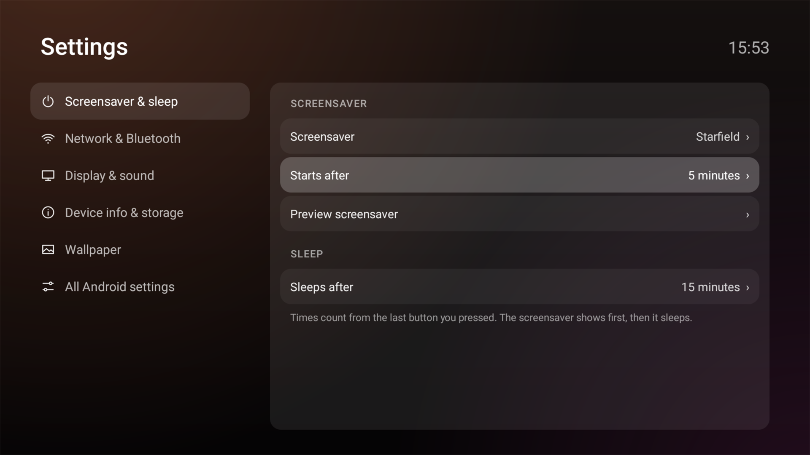

# Cleaning your TV safely

TV Detox does two jobs. The home screen is automatic. Turning off the junk is a judgement
call for every app, so it is left to whoever is driving the setup. This page is that
judgement, plus the rules that keep it reversible.

Start with `sh candidates.sh <TV_IP>`. It lists every app on the TV with a verdict, and
changes nothing:

| verdict | meaning |
| --- | --- |
| `never` | the TV needs it, or Android keeps it running whatever you do. Leave it on. |
| `keep` | it carries a feature you may use, casting or search or Live TV. Off only if unused. |
| `safe` | commonly preinstalled junk: ads, sponsored rows, unused vendor and Google apps. |
| `review` | nothing known about it. Leave it on unless you know what it is. |

Work down the list from the top. Turn off, wait, check the TV still works.

## The four rules

### 1. Turn apps off, never uninstall them

`pm disable-user --user 0 <package>` hides an app and `pm enable <package>` brings it back.
`pm uninstall` on a system app cannot be undone from the TV. Everything on the TV should be
reversible from the TV, so disable, and keep every package you touch in the undo list.

### 2. Never turn off what starts the TV

The screen, the remote, the keyboard, the settings app and the package installer are load
bearing. If you turn one off you can end up with a TV that boots to a black screen, and ADB
is your only way back. `candidates.sh` marks these `never` for you.

### 3. Apps Android marks PERSISTENT cannot be turned off

Some apps restart themselves the moment the system comes up. `pm disable-user` will report
success and the app is back after a reboot:

```
adb shell dumpsys package com.tcl.guard | grep -m1 pkgFlags
# pkgFlags=[ SYSTEM HAS_CODE PERSISTENT ALLOW_CLEAR_USER_DATA ... ]
```

If you see `PERSISTENT`, leave it alone. Turning it off does not stick, and on a few TVs it
upsets the system instead. `candidates.sh` marks these `never` too.

### 4. Test casting if you cast

Casting is not one app you can spot by name. On Google TV the receiver is
`com.google.android.apps.mediashell`, and it is easy to disable while sweeping up
"media"-looking names. Keep it on, and after a batch that touched anything Google, cast a
video from your phone and confirm the TV still shows up. If it does not, `pm enable
com.google.android.apps.mediashell` and reboot. On a TV that never casts, it is safe off.

## A package name is not always the app

A package name doesn't always say what the app is. Prime Video, for example, installs as
`com.amazon.amazonvideo.livingroom`, and Netflix as `com.netflix.ninja`. Before turning
something off, look at what is actually inside:

```
adb shell cmd package resolve-activity --brief <package>
```

If it is an app you installed and use, it belongs with your apps whatever it is called.

## Do it in batches

Turn off five or ten apps, then check the TV: change the input, open the settings, play
something, cast something. When a batch is clean, do the next one. If the TV misbehaves you
then know which batch to undo, instead of guessing across forty changes.

A reboot after each batch is worth it. Disabling an app looks instant but its processes and
services can linger until the system restarts, so the TV is only really tested on a fresh
boot.

## If something goes wrong

- Bring one app back: `adb shell pm enable <package>`
- Bring back the launchers `install.sh` turned off: `sh undo.sh <TV_IP>`. It only knows about
  what `install.sh` turned off. Apps you turn off by hand from this guide aren't on its list,
  so write each one down as you go, and turn them back on with `pm enable`.
- Screen is black but the TV answers ADB: re-enable `com.google.android.tvlauncher`, boot to
  it, and run `undo.sh`.

## What is not a package

Some annoyances are the TV's own behaviour, not an app. A TV that opens Live TV or an input
at boot is set up that way in its own settings, usually under the system or power menu. No
package to disable. Set it on the remote instead.

## After the cleanup: screensaver and sleep



Turning off the screensaver you had, like Google TV's `dreamx` or Android TV's Ambient Mode
(`com.google.android.backdrop`), leaves the TV with a different one or none. Pick what replaces
it on the home screen: **Settings** tile, then **Screensaver & sleep**.

- **Screensaver** lists every screensaver on the TV, plus Off. **Preview screensaver** shows it
  straight away.
- **Starts after** and **Sleeps after** set the two timers. Sleep can't be set before the
  screensaver starts, so the screensaver always gets its turn.
- `install.sh` grants the two permissions these need, over adb. Without them the page only shows
  the current values; run `install.sh` again to fix that.

The other pages show the network and paired Bluetooth devices, the picture and sound, and the
device's memory and storage, with buttons to the TV's own screens for what an app can't change.

**TVs and boxes.** A TV has its own screen, speakers and HDMI inputs; a box like NVIDIA Shield,
Chromecast or a Mi Box plugs into one and has none of them. The Settings screen tells them apart
by those inputs. Only a TV gets **Picture & brightness**: a box's picture is the TV's, set with the
TV's remote. On NVIDIA Shield, resolution, HDR and audio are under TV settings, **Device
Preferences**, **Display & Sound**. Android TV's own Display & Sound page is listed there too, but
it's missing and crashes if started.

## Reference

### Never turn off

| package | what it is |
| --- | --- |
| `com.google.android.gms`, `com.google.android.gsf` | Google Play services and framework |
| `com.android.vending` | Google Play Store |
| `com.android.tv.settings`, `com.android.settings` | Settings |
| `com.android.systemui` | System UI |
| `com.android.providers.*` | settings, media, contacts, downloads storage |
| `com.android.bluetooth` | Bluetooth and the remote |
| `com.android.packageinstaller`, `com.google.android.packageinstaller` | installing apps |
| `com.dolby.android.audio.service` | audio processing, no sound without it on some TVs |
| keyboards | `com.google.android.inputmethod.latin` (Gboard), `com.android.inputmethod.latin`, `com.tcl.inputmethod.international` |
| setup apps | `com.google.android.tungsten.setupwraith`, `com.google.android.partnersetup`, `com.google.android.onetimeinitializer` |
| TCL basics | `com.tcl.tvinput` (HDMI and tuner), `com.tcl.tv` (Live TV, also the screen that shows HDMI), `com.tcl.suspension` (input picker), `com.tcl.providers.config`, `com.tcl.useragreement` |
| Philips basics | `org.droidtv.` prefix: `homeintentresolver`, `GlobalKey`, `playtv`, `hdmiservice`, `channels`, `tvsystemui`, `tvpowermanagerservice`, `tv.tptvservice` ([TV Slim never-disable list](https://tvslim.app/packages/)); `lkb`, `xtv`, `settings`, `menudataapp`, `eum`, `aurora` ([tvdebloat DO NOT DISABLE block](https://tvdebloat.com/data/sources/philips-50pus8517.txt); removing `eum` or `aurora` leaves persistent `xtv` retrying) |
| NVIDIA Shield basics | `com.nvidia.shieldservice`, `com.nvidia.blakepairing` and `com.nvidia.shield.remote.server` (the remote), `com.nvidia.bluetooth.ShieldBluetoothManager`, `com.nvidia.irtuner` (IR blaster), `com.nvidia.nvaudiosvc` (audio). Android keeps them running |
| `com.google.android.apps.mediashell` | casting, if you cast |
| anything flagged `PERSISTENT` | it will not stay off |

### Commonly safe to turn off

Ads and sponsored rows, unused Google apps, vendor filler and serial port relics:

| package | what it is |
| --- | --- |
| `com.google.android.tvrecommendations` | Google TV sponsored row |
| `com.google.android.backdrop` | Google TV backdrop ads. On Android TV it's also the Ambient Mode screensaver (about 150 MB on a Shield): pick another screensaver first |
| `com.google.android.videos`, `com.google.android.youtube.tvmusic`, `com.google.android.play.games` | Google apps few TVs use |
| `com.google.android.feedback` | Google feedback |
| `com.tcl.waterfall.overseas`, `com.tcl.esticker` | TCL content feed and stickers |
| `com.tcl.dashboard`, `com.tcl.messagebox` | TCL panels and popups |
| `com.tcl.copydatatotv`, `com.tcl.audioplayer`, `com.tcl.imageplayer`, `com.tcl.videoplayer` | TCL media helpers |
| `com.tcl.usercenter`, `com.tcl.keyhelp` | TCL account and help |
| `com.nvidia.stats`, `com.nvidia.feedback` | NVIDIA usage stats and feedback |
| `com.nvidia.shield.welcome`, `com.nvidia.diagtools`, `com.nvidia.developerwidget` | NVIDIA welcome tour, diagnostics and developer widget |
| `com.android.printspooler`, `com.android.htmlviewer`, `com.android.gallery3d` | Android spare parts: printing, HTML viewer, photo gallery |

### Depends on you

Turn these off only if you do not use the feature:

| package | feature |
| --- | --- |
| `com.google.android.apps.mediashell` | casting from your phone |
| `com.google.android.katniss` | Google TV search and voice |
| `com.google.android.tv.assistant` | Google Assistant |
| `com.google.android.marvin.talkback` | TalkBack screen reader |
| `com.google.android.tv.remote.service` | remote control from your phone |
| `com.google.android.tts` | text to speech |
| `com.nvidia.tegrazone3` | GeForce NOW and NVIDIA's games, on a Shield |
| `com.android.dreams.basic`, `com.google.android.apps.tv.dreamx` | the screensaver. Keep one on an OLED TV, it prevents burn-in; pick which in **Settings**, **Screensaver & sleep** |

Vendors rename and add to these lists, so treat them as strong hints, not gospel. When in
doubt, leave it on: a slow TV is better than a TV you cannot use.
